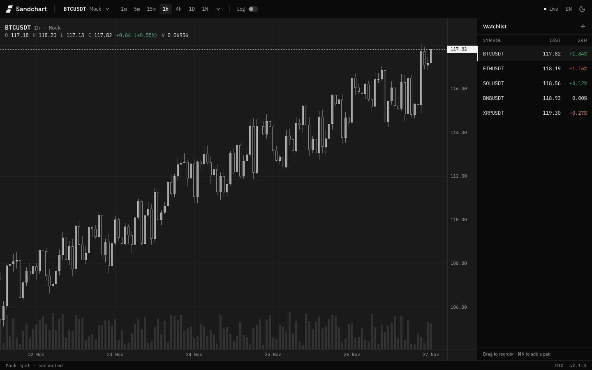
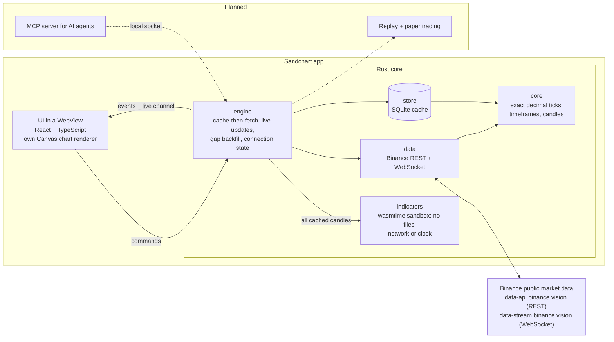
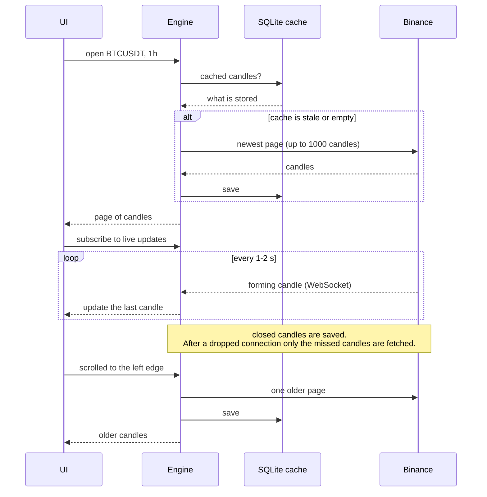

# Sandchart

**An open-source desktop chart terminal written in Rust.** Fast candlestick charts for Binance spot markets, a local cache that opens charts instantly, and no account, subscription, API keys or telemetry.

[](https://github.com/kennnyz/sandchart/actions/workflows/ci.yml)




<sub>Live Binance data, 27 November 2026. The interface is set to Russian; English is one click away.</sub>

## Why Sandchart

- **Your machine, your data.** Candles are cached in a local SQLite file. Charts open from cache instantly and keep working offline. There is nothing to sign in to and nothing that phones home.
- **Nothing to steal.** The app never asks for exchange keys and only talks to Binance's public market-data hosts.
- **Exact numbers.** Prices and volumes are integers counted in the pair's tick and lot size, from the exchange to the screen. No floating-point money anywhere in the core.
- **Our own renderer.** The chart is a small Canvas 2D engine written for this project, not a wrapped charting library. A frame takes well under a millisecond to draw.
- **Built to be extended.** Indicators are WebAssembly modules that run in a sandbox: they cannot read your files or reach the network. Next: a replay you can share and anyone can reproduce, and tools for AI agents. See the [roadmap](#roadmap).

## Features

- Candlestick chart with volume: pan and zoom with mouse or trackpad (including pinch), crosshair with an OHLC legend, auto scale and logarithmic scale. The price axis grows to fit long prices such as `120 587.50` or `0.00001234`.
- Timeframes from 1 minute to 1 month, each fetched natively from Binance and cached.
- Live updates of the forming candle over WebSocket. After a dropped connection or a sleeping laptop, the missed candles are fetched again, so the chart has no gaps.
- Polite to the exchange: retries back off (1, 2, 4… up to 30 s) and honour Binance's `Retry-After`.
- Search over all Binance spot pairs (Cmd/Ctrl+K) and a watchlist with last price and 24 h change: add with the `+` button, drag to reorder, hide the panel to give the chart more room.
- Indicators: SMA, EMA, Bollinger bands, RSI and MACD are built in, and you can add your own as WebAssembly modules. They run in a sandbox with no files, no network and no clock, under memory and work limits. Lines, histograms, markers and bands draw over the candles or in panes of their own, and a repaint check warns about indicators that change their past. Write one in Rust with the `sandchart-indicator` command, or let your coding agent do it: see [Writing indicators](docs/indicators.md).
- Monochrome candles (colour appears only in numbers and indicator series), dark and light themes, English and Russian interface.
- Builds for macOS (Apple silicon and Intel), Windows and Linux.

## Architecture

Sandchart is one desktop binary. A Rust core owns the data; a thin TypeScript UI draws it.



| Crate or folder | What it does |
| --- | --- |
| [`crates/core`](crates/core) | Shared types: instruments, candles, timeframes, and decimal strings parsed into integer ticks without floats. |
| [`crates/store`](crates/store) | The SQLite cache: instruments, candles per pair and timeframe, the start of each pair's history, and the watchlist. Migrations go up and down. |
| [`crates/data`](crates/data) | Data providers behind one `Provider` trait. Binance today: pair list, history pages, 24 h changes, and a live WebSocket stream that reconnects with backoff and an idle timeout. |
| [`crates/engine`](crates/engine) | The brain: serves charts from cache first, fetches only what is missing, keeps live subscriptions, backfills gaps after reconnects, and tracks the connection state. |
| [`crates/indicators`](crates/indicators) | The indicator host: runs WebAssembly indicators in a sandbox (no files, network, env or real clock) under memory and work limits, and checks what they declare and return. The five built-in indicators are compiled in. |
| [`crates/indicator-cli`](crates/indicator-cli) | The `sandchart-indicator` command for authors: `new`, `build` and `test`, using the same host as the app. |
| [`indicators`](indicators) | The indicator SDK (`sandchart-indicator`, with the contract `sdk/wit/indicator.wit`), the built-in indicators, and test modules for the host. A separate Cargo workspace that builds for WebAssembly. |
| [`app/src-tauri`](app/src-tauri) | The desktop shell: exposes the engine to the UI as typed commands and a live-event channel, with a strict content security policy and no file-system or shell access. |
| [`app/ui`](app/ui) | The interface: Canvas chart, search, watchlist, status bar and states. It runs in a normal browser against a built-in mock too, which is how the end-to-end tests work. |

### How candles get to the screen



Nothing is reloaded wholesale: a chart you have opened before comes straight from the cache, and the exchange only sees requests for candles the cache does not have.

## Roadmap

| Version | Focus |
| --- | --- |
| 0.1 | Live Binance charts, local cache, own renderer, search, watchlist, themes, unsigned builds |
| **0.2** (this release) | Indicators as sandboxed WebAssembly modules, with an SDK and a command to build and test them |
| 0.3 | Replay: step through history candle by candle, paper trades with stop and take-profit, statistics in R, a shareable `.replay` file that gives anyone the same result |
| 0.4 | An MCP server so AI agents can read charts, build indicators and run replays |
| 0.5 | Drawing tools and alerts |
| 1.0 | Signed builds and auto-update |

The order can change; the design decisions are recorded in [ADR 0001](docs/adr/0001-wasm-indicators-and-tauri.md).

## Install

Download the file for your system from the [Releases](../../releases) page:

| System | File |
| --- | --- |
| macOS, Apple silicon | `Sandchart_<version>_aarch64.dmg` |
| macOS, Intel | `Sandchart_<version>_x64.dmg` |
| Windows | `Sandchart_<version>_x64_en-US.msi` |
| Linux | `.AppImage` or `.deb` |

The builds are not signed yet, so the operating system will warn you the first time.

### macOS

1. Open the `.dmg` and drag Sandchart to Applications.
2. Try to open it once. macOS says it cannot verify the app.
3. Open System Settings, Privacy & Security, scroll to the message about Sandchart and click Open Anyway.

If you prefer a terminal, `xattr -dr com.apple.quarantine /Applications/Sandchart.app` removes the quarantine flag.

### Windows

Run the `.msi`. If SmartScreen shows "Windows protected your PC", click More info, then Run anyway.

### Linux

For the AppImage: `chmod +x Sandchart_*.AppImage`, then run it. For the `.deb`: `sudo apt install ./Sandchart_*.deb`.

## Write your own indicators

Indicators are WebAssembly modules. The [guide](docs/indicators.md) shows how to write one in Rust, or how to hand the job to your coding agent. You need the `sandchart-indicator` command: download the archive for your system (`sandchart-indicator-<target>.tar.gz`, or `.zip` on Windows) from the [Releases](../../releases) page and put the binary on your `PATH`, or run:

```sh
rustup target add wasm32-wasip2
cargo install --git https://github.com/kennnyz/sandchart sandchart-indicator-cli
```

## Verify your download

Every release has a `SHA256SUMS` file and a build provenance attestation made by GitHub Actions.

Check the checksum (run in the folder with the downloads):

```sh
sha256sum --check --ignore-missing SHA256SUMS      # Linux
shasum -a 256 --check --ignore-missing SHA256SUMS  # macOS
```

On Windows, compare `Get-FileHash .\Sandchart_<version>_x64_en-US.msi` with the matching line in `SHA256SUMS`.

Check that the file was built by this repository's workflow, with the [GitHub CLI](https://cli.github.com/):

```sh
gh attestation verify Sandchart_<version>_aarch64.dmg --repo kennnyz/sandchart
```

## Build from source

You need Rust (stable, installed with [rustup](https://rustup.rs/)) with the `wasm32-wasip2` target (`rustup target add wasm32-wasip2`), Node.js 22 and pnpm 10. On Linux also install the Tauri system packages:

```sh
sudo apt-get install -y build-essential libwebkit2gtk-4.1-dev libxdo-dev libssl-dev \
  libayatana-appindicator3-dev librsvg2-dev
```

Then:

```sh
cargo build --manifest-path indicators/Cargo.toml --target wasm32-wasip2 --release   # the built-in indicators, embedded in the app
pnpm --dir app/ui install --frozen-lockfile
pnpm --dir app/ui tauri build    # macOS and Linux shell; bundles land in target/release/bundle/
```

On Windows the `tauri` script in `app/ui/package.json` does not work in `cmd`; run the CLI from the `app` folder instead: `cd app` and `node ui/node_modules/@tauri-apps/cli/tauri.js build`.

The UI also runs in a normal browser against a built-in mock, without Rust: `pnpm --dir app/ui dev`.

Tests:

```sh
cargo test --workspace
pnpm --dir app/ui test
pnpm --dir app/ui exec playwright install chromium && pnpm --dir app/ui exec playwright test
```

Contributors and coding agents: see [AGENTS.md](AGENTS.md).

## Privacy and network

Sandchart holds no exchange API keys, has no accounts and sends no telemetry. The only outgoing connections are to the public Binance market-data hosts:

- `data-api.binance.vision` (REST: instruments, candles, 24 h change)
- `data-stream.binance.vision` (WebSocket: live candles)

Your watchlist and cached candles stay in a local SQLite file in your user data folder.

## Third-party notices

Bundled fonts, under the SIL Open Font License 1.1 (licence texts in `app/ui/src/assets/fonts`):

- IBM Plex Sans
- IBM Plex Mono
- Space Grotesk

Rust dependencies under the MPL-2.0 (file-level copyleft, used unmodified, allowed as exceptions in `deny.toml`): `cssparser`, `cssparser-macros`, `selectors`, `dtoa-short`, `option-ext`. All of them come in through Tauri.

The WebAssembly runtime (wasmtime, cranelift and the WASI crates) is Apache-2.0 WITH LLVM-exception, which `deny.toml` allows for every crate.

Every other dependency must be MIT, Apache-2.0, BSD-2-Clause, BSD-3-Clause, ISC, Zlib or Unicode-3.0; `cargo deny check` enforces this in CI. Icons are from [Lucide](https://lucide.dev) (ISC).

## Licence

Dual-licensed under either of [Apache License 2.0](LICENSE-APACHE) or [MIT licence](LICENSE-MIT), at your option.
