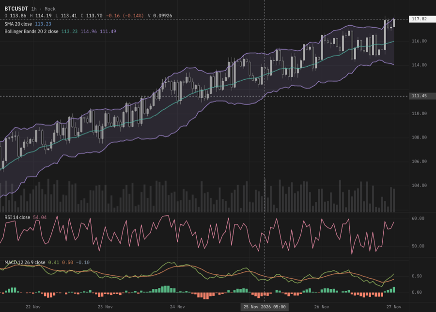

# Writing indicators

An indicator is a small program that Sandchart runs on the candles of the open chart. It returns series of numbers, and Sandchart draws them: lines and bands over the candles, or lines and bars in a pane under the chart.

This guide is enough to write one without reading Sandchart's code. It covers the sandbox, the tools, the contract, the SDK, a full example, the output kinds, repainting, the limits and the errors you can hit.

- [What an indicator is](#what-an-indicator-is)
- [Install the tools](#install-the-tools)
- [Create, build and test](#create-build-and-test)
- [Add it to the app](#add-it-to-the-app)
- [The contract](#the-contract)
- [The SDK](#the-sdk)
- [Example: Bollinger bands](#example-bollinger-bands)
- [Output kinds](#output-kinds)
- [Repainting](#repainting)
- [Limits and errors](#limits-and-errors)
- [Other languages](#other-languages)
- [A prompt for your coding agent](#a-prompt-for-your-coding-agent)

## What an indicator is

An indicator is a WebAssembly component. The app loads the `.wasm` file and calls two functions:

- `meta()` says what the indicator is: its id, name, version, parameters and output series.
- `compute(params, candles)` takes the parameter values and the candles, and returns the values of every series.

`compute` is a pure function. It gets all cached candles of the chart (the newest 100 000 at most, oldest first) and returns whole series. Every call runs in a fresh sandbox, so nothing is kept between calls.

Prices and volumes arrive as `f64` in price units (for example `117.82`), not as integer ticks. `NaN` means "no value at this bar", and the chart draws a gap.

### What it cannot do

The sandbox gives an indicator nothing but its inputs:

- No files, no network, no environment variables, no command-line arguments.
- The clocks always read 0. Use the candle `time` field if you need a time.
- Random numbers are seeded with a fixed value, so a run gives the same result every time.
- `println!` and `eprintln!` work. The output is collected into a log of at most 16 KiB and shown in the app and in `test`.
- It has a memory limit and a work limit (see [Limits and errors](#limits-and-errors)).

A module that imports anything other than WASI 0.2 is rejected when it loads. The app adds no hosts to its network list because of indicators: see "Privacy and network" in the [README](../README.md).

## Install the tools

You need Rust (stable, from [rustup](https://rustup.rs/)) and the WebAssembly target:

```sh
rustup target add wasm32-wasip2
```

Then the `sandchart-indicator` command. Either download it from the [Releases](https://github.com/kennnyz/sandchart/releases) page (the archive `sandchart-indicator-<target>.tar.gz`, or `.zip` for Windows, holds one binary; put it on your `PATH`), or build it from a clone:

```sh
git clone https://github.com/kennnyz/sandchart
cd sandchart
cargo build --manifest-path indicators/Cargo.toml --target wasm32-wasip2 --release
cargo install --path crates/indicator-cli
```

The second command builds the built-in indicators, which the tool embeds. `cargo install --git https://github.com/kennnyz/sandchart sandchart-indicator-cli` does not work for that reason: the built files are not in the repository.

`sandchart-indicator --help` lists three commands: `new`, `build` and `test`.

## Create, build and test

```sh
sandchart-indicator new my-cross
cd my-cross
sandchart-indicator build
sandchart-indicator test target/wasm32-wasip2/release/my_cross.wasm
```

`new <name>` creates `./<name>` with a working indicator (a fast and a slow moving average with markers where they cross), a `README.md` and an `AGENTS.md` for coding agents. The name is lower-case letters, digits, `-` and `_`, starting with a letter. The indicator id becomes `local.<name>`. Cargo turns `-` into `_` in the file name, so `my-cross` builds `my_cross.wasm`.

The new project depends on the SDK at git tag `v0.2.0`, and that tag exists once Sandchart 0.2.0 is released. Until then, point the dependency at a checkout of this repository. In the project's `Cargo.toml`, replace the `sandchart-indicator` line with:

```toml
sandchart-indicator = { path = "/path/to/sandchart/indicators/sdk" }
```

`build` runs `cargo build --release --target wasm32-wasip2` and then loads the result with the same host the app uses. On success it prints the id, the version and the path of the `.wasm`:

```text
ok local.my-cross 0.1.0 → /…/my-cross/target/wasm32-wasip2/release/my_cross.wasm
```

If the target is missing it tells you to run `rustup target add wasm32-wasip2`. If the module does not pass the checks in this guide, it prints what to change and exits with a non-zero code.

`test <file.wasm>` runs the module on candles and prints what the app would see:

```text
local.my-cross 0.1.0 on 2000 bars
  fast (line, price, 2000 values): last 5: 29696.18 29736.19 29783.81 29818.71 29873.70
  slow (line, price, 2000 values): last 5: 29395.86 29433.52 29473.01 29523.59 29587.68
  cross (markers, price, 203 markers): last 5: up@1956 down@1957 up@1967 down@1978 up@1990
fuel: 727932 of 600000000 (0.12%)
deterministic: yes
```

The numbers are printed in full; they are cut here. `test` shows the last five values of every series (`NaN` for a gap), the fuel used, anything the module printed, and whether two runs agree. A line starting with `warning:` is worth reading; `warning: repaints …` is explained [below](#repainting). If the module prints anything, the output follows under `log:`. A failure prints `error: …` on stderr, for example `error: the indicator returned an error: bad period`, and the exit code is non-zero.

Options of `test`:

| Flag | Meaning |
| --- | --- |
| `--csv FILE` | Use your candles. The header is `time,open,high,low,close,volume`, one bar per line, oldest first, `time` in Unix milliseconds. Without it, `test` generates 2000 hourly bars from a fixed seed. |
| `--param id=value` | Set a parameter. Repeat for more. The value is checked against the module's declared kind and range. |
| `--json` | Print one JSON object instead of text. |

The JSON object has these fields: `id`, `version`, `bars`, `series` (a list of `{id, kind, pane, count, last}`), `fuel_used`, `fuel_percent`, `log`, `deterministic`, `repaints` (`null`, or `{series, index}`) and `errors` (a list of strings; empty on success).

## Add it to the app

Open Sandchart, click Indicators, then Add from file, and pick the `.wasm`. The app checks it, runs it on 2000 sample bars with the default parameters to see whether it repaints, and shows the result. (`sandchart-indicator test` uses the `--param` values you pass, so the two can differ for an indicator that repaints only with some parameters.) It then appears under Installed in the same dialog. Click an indicator in the list to add it to the chart.

Installing a module with the id of an installed one replaces it, after a confirmation. Removing one (the cross next to it) asks first and removes its indicators from the chart too.

If an installed module cannot be loaded when the app starts (its file was changed or deleted, or a newer app rejects it), the dialog lists it under Installed with the reason. Its indicators stay saved, hidden from the chart, and come back once the module loads again; install a fixed build or remove it. Your parameter values stay where they still fit: a saved value that no longer exists, has the wrong kind or is out of range is dropped, and the default is used.

## The contract

The contract is one file, [`indicators/sdk/wit/indicator.wit`](../indicators/sdk/wit/indicator.wit). The SDK and the app both read it. The Rust SDK turns it into the types below, so you rarely read WIT yourself.

What `meta()` returns:

| Field | Meaning |
| --- | --- |
| `id` | `author.name`: lower-case letters, digits, `_` and `-`, exactly one `.`, each part starting with a letter or digit, at most 64 bytes. Must not start with `builtin.` (reserved for the indicators inside the app; `build` refuses it too). |
| `name` | Shown in the app. Not empty, at most 128 bytes. |
| `version` | Semver, such as `0.1.0`, at most 64 bytes. |
| `description` | One line, at most 4 KiB. |
| `params` | The parameters the user can set. At most 64. |
| `series` | The series you return. At least one, at most 64. |

A parameter has an `id`, a `label`, a `kind` and a `default`. The kinds are `Int((min, max))`, `Float((min, max))`, `Boolean` and `Choice(options)`. Parameter ids are unique, not empty, at most 64 bytes, and use only lower-case letters, digits, `_` and `-`; a label is at most 64 bytes. The default must be of the kind and inside the range or list. An int range needs `min <= max` with both bounds within ±(2^53 − 1), the largest integers the app's UI holds exactly. A float range needs `min <= max` with both bounds finite: no NaN and no infinity, because the app sends parameters as JSON, which has neither. A choice needs 1 to 256 options, each not empty, at most 64 bytes and listed once.

A series has an `id`, a `label`, a `kind`, a `pane` and a `color`. The kinds are `Line`, `Histogram`, `Markers` and `Band(a, b)`. The pane is `Pane::Price` (over the candles) or `Pane::Own` (a pane of its own under the chart). The `color` is a palette slot from 0 to 7. Each theme maps the slots to colors, so an indicator never picks its own colors.

Rules the app enforces on `meta`:

- Series ids are unique, not empty, at most 64 bytes, and use only lower-case letters, digits, `_` and `-`. Series labels are at most 64 bytes.
- `color` is at most 7.
- A `Markers` series is on `Pane::Price`.
- `Band(a, b)` names two different `Line` series of the same module, on the same pane as the band.
- Every default fits its kind and range.
- `version` is semver, and `id` follows the pattern above.

Rules the app enforces on what `compute` returns:

- Every declared series is returned exactly once, and no undeclared series. The order does not matter.
- `Line` and `Histogram` series return `Values` with exactly one value per candle.
- A `Markers` series returns `Markers`, every marker `index` is below the number of candles, and a marker `text` is at most 64 bytes.
- A `Band` series carries no data of its own. Return an empty list of values for it; the app ignores what is there and fills between the two lines.
- `+inf` and `-inf` in values become `NaN`, so they draw as gaps. Autoscale ignores non-finite values.

`compute` gets every parameter, resolved: the saved value when it still fits the spec, the default otherwise. So `params.int("period")` is always present and in range. `compute` can also return an error string. The app shows it as "the indicator returned an error: …" (cut to its first 1 KiB) and draws nothing for that indicator.

## The SDK

The SDK is the Rust crate `sandchart-indicator` (in [`indicators/sdk`](../indicators/sdk)). You implement the `Indicator` trait and export it:

```rust
use sandchart_indicator::{Candle, Indicator, Meta, ParamValue, SeriesOut};

struct MyIndicator;

impl Indicator for MyIndicator {
    fn meta() -> Meta { /* … */ }
    fn compute(params: Vec<(String, ParamValue)>, candles: Vec<Candle>)
        -> Result<Vec<SeriesOut>, String> { /* … */ }
}

sandchart_indicator::export!(MyIndicator with_types_in sandchart_indicator::bindings);
```

A `Candle` has `time` (`i64`, open time in Unix milliseconds), `open`, `high`, `low`, `close` and `volume` (`f64`).

### `Params`

`Params::new(params)` wraps the list that `compute` receives. Each getter returns `Err("missing param \"id\"")` or `Err("param \"id\" is not int")` when it does not fit, so you can use `?`:

| Method | Returns |
| --- | --- |
| `int(id)` | `Result<i64, String>` |
| `float(id)` | `Result<f64, String>` |
| `boolean(id)` | `Result<bool, String>` |
| `choice(id)` | `Result<&str, String>` |

### `ta`

`sandchart_indicator::ta` has helpers. Each takes `&[f64]` and a period and returns a `Vec<f64>` of the same length, with `NaN` until the first full window. A period of 0, or longer than the input, gives all `NaN`.

| Function | What it computes |
| --- | --- |
| `sma(src, period)` | Simple moving average. |
| `ema(src, period)` | Exponential moving average, alpha `2 / (period + 1)`, seeded with the SMA of the first `period` values. |
| `rma(src, period)` | Wilder's moving average, alpha `1 / period`. |
| `stdev(src, period)` | Population standard deviation over a rolling window. |
| `highest(src, period)` | Highest value over a rolling window. |
| `lowest(src, period)` | Lowest value over a rolling window. |
| `source(candles, name)` | A price series by name. `name` is one of `ta::SOURCES`: `open`, `high`, `low`, `close`, `hl2`, `hlc3`, `ohlc4`. An unknown name is an `Err`. |

`ta::SOURCES` is handy for a `Choice` parameter: `ParamKind::Choice(ta::SOURCES.iter().map(|s| s.to_string()).collect())`. A window that holds a `NaN` gives `NaN` (`highest` and `lowest` too), and `ema` and `rma` start again after a `NaN`.

## Example: Bollinger bands

This is the built-in Bollinger indicator, [`indicators/builtin/bollinger`](../indicators/builtin/bollinger), with a user id. It has three parameters and four series: a basis line, an upper and a lower line, and a fill between them.

```rust
use sandchart_indicator::{
    Candle, Indicator, Meta, Pane, ParamKind, ParamSpec, ParamValue, Params, SeriesData,
    SeriesKind, SeriesOut, SeriesSpec, ta,
};

struct Bollinger;

fn line(id: &str, label: &str, color: u8) -> SeriesSpec {
    SeriesSpec {
        id: id.into(),
        label: label.into(),
        kind: SeriesKind::Line,
        pane: Pane::Price,
        color,
    }
}

fn values(id: &str, v: Vec<f64>) -> SeriesOut {
    SeriesOut { id: id.into(), data: SeriesData::Values(v) }
}

impl Indicator for Bollinger {
    fn meta() -> Meta {
        Meta {
            id: "me.bollinger".into(), // not "builtin.…": that prefix is reserved
            name: "Bollinger Bands".into(),
            version: "0.1.0".into(),
            description: "Moving average with bands at a number of standard deviations".into(),
            params: vec![
                ParamSpec {
                    id: "period".into(),
                    label: "Period".into(),
                    kind: ParamKind::Int((2, 1000)),
                    default: ParamValue::Int(20),
                },
                ParamSpec {
                    id: "mult".into(),
                    label: "Deviations".into(),
                    kind: ParamKind::Float((0.1, 10.0)),
                    default: ParamValue::Float(2.0),
                },
                ParamSpec {
                    id: "source".into(),
                    label: "Source".into(),
                    kind: ParamKind::Choice(ta::SOURCES.iter().map(|s| s.to_string()).collect()),
                    default: ParamValue::Choice("close".into()),
                },
            ],
            series: vec![
                line("basis", "Basis", 2),
                line("upper", "Upper", 3),
                line("lower", "Lower", 3),
                SeriesSpec {
                    id: "fill".into(),
                    label: "Fill".into(),
                    kind: SeriesKind::Band(("upper".into(), "lower".into())),
                    pane: Pane::Price,
                    color: 3,
                },
            ],
        }
    }

    fn compute(
        params: Vec<(String, ParamValue)>,
        candles: Vec<Candle>,
    ) -> Result<Vec<SeriesOut>, String> {
        let p = Params::new(params);
        let period = usize::try_from(p.int("period")?).map_err(|_| "period must be positive")?;
        let mult = p.float("mult")?;
        let src = ta::source(&candles, p.choice("source")?)?;
        let basis = ta::sma(&src, period);
        let dev = ta::stdev(&src, period);
        let upper = basis.iter().zip(&dev).map(|(m, d)| m + mult * d).collect();
        let lower = basis.iter().zip(&dev).map(|(m, d)| m - mult * d).collect();
        Ok(vec![
            values("basis", basis),
            values("upper", upper),
            values("lower", lower),
            values("fill", Vec::new()), // a band carries no data
        ])
    }
}

sandchart_indicator::export!(Bollinger with_types_in sandchart_indicator::bindings);
```

The project needs `crate-type = ["cdylib"]` under `[lib]` in `Cargo.toml`. `sandchart-indicator new` writes that, and a release profile with `strip = true` that keeps the file small.

The first `period - 1` values of `basis`, `upper` and `lower` are `NaN`, so the chart draws nothing there. Nothing in `compute` looks at a later bar than the one it computes, so it does not repaint.

## Output kinds

Here is a chart with lines, a band and a histogram: SMA and the Bollinger lines over the candles, the Bollinger fill between its two lines, RSI as a line in its own pane, and MACD in a pane of its own with a histogram and two lines.



| Kind | Where | What it draws | What you return |
| --- | --- | --- | --- |
| `Line` | Price or own pane | A line through the values. A `NaN` breaks it. | One value per candle. |
| `Histogram` | Either pane; usually its own | Bars from zero to the value, in the theme's up color above zero and its down color below, until the user picks a color for the series. A `NaN` draws no bar. The pane's scale always includes 0. | One value per candle. |
| `Markers` | Price pane only | A small shape at a bar: `Up` below the low of the candle, `Down` above its high, `Dot` at its close. A marker may carry a short `text`, drawn to its right. | A list of `Marker { index, shape, text }`. `index` counts from the first candle you received. |
| `Band(a, b)` | Same pane as its two lines | A translucent fill between line `a` and line `b`, drawn under the candles. | Nothing (an empty list). |

An own pane is 120 px high. The price pane keeps at least 40 % of the chart height, and when many own panes do not fit, they share the rest equally. Every series has a legend entry, and the user can hide an indicator, change its parameters and pick a color slot for each series.

There is no screenshot of markers here. The project that `sandchart-indicator new` creates draws them, so you can see them in the app after you add it.

## Repainting

An indicator repaints when the value at a bar changes after later bars arrive. A common cause is looking ahead (reading `candles[i + 1]` to compute bar `i`) or scaling by the maximum of the whole window. A repainting indicator shows values that nobody could have known at that bar. That matters for any use that replays history, because the chart then shows the past with knowledge of the future. A replay mode is planned, and indicators that do not repaint will be the ones that are safe to replay.

The last candle of a live chart is still forming, so its values move with each tick. That is normal and is not repainting.

`sandchart-indicator test` checks this. It runs the module on all bars and again on the first 25 %, 50 %, 75 % of the bars and all but the last one (on the 2000 generated bars: 500, 1000, 1500 and 1999), and compares every value both runs share. `NaN` equals `NaN`; anything else must be identical to the last bit. If a value differs, `test` prints:

```text
warning: repaints (series "max", first difference at bar 0)
```

The app runs the same check when you install a module, and then marks it with "Repaints: past values can change". The module still loads and draws: it is a warning, not an error.

`test` also runs the module twice on the same input and fails if the output differs, since `compute` must be a pure function of its parameters and candles.

## Limits and errors

Limits of every `compute` call:

| Limit | Value |
| --- | --- |
| Memory | 256 MiB in total, over all memories of the module. |
| Work | 600 000 000 units of fuel. Fuel counts executed instructions, so the limit is the same on every machine. `test` prints the share you use; the built-in MACD uses about 4.5 % on 100 000 bars. |
| Time | 10 seconds of wall time, as a backstop if fuel does not stop it. |
| Candles | The newest 100 000 cached candles of the chart. |
| File size | 20 MiB per `.wasm`. Build in release mode with `strip = true`. |
| Log | The first 16 KiB of what the module prints. The rest is dropped. |
| Output | 64 MiB copied out of the module per call: enough for 64 series of 100 000 values. |

A call that hits a limit stops. Other indicators on the chart keep working.

When the app or `test` cannot load a module, the message names the problem:

| Message starts with | Meaning and fix |
| --- | --- |
| `the module is larger than 20 MiB` | Build with `--release` and `strip = true`. |
| `not an indicator component` | The file is not a WebAssembly component. If it says "core WebAssembly module", build for `wasm32-wasip2` with the SDK. |
| `the module does not implement sandchart:indicator/indicator@0.1.0` | The module does not export the contract. Use the SDK's `Indicator` trait and `export!`, and rebuild. A module built for another contract version is rejected the same way. |
| `the module imports …, which indicators may not use` | The module needs something other than WASI 0.2. Remove the dependency that needs it. |
| `invalid meta: …` | `meta()` broke a rule listed in [The contract](#the-contract). The text names the item. |
| `meta() failed: …` | `meta()` crashed or hit a limit. |

When a call to `compute` fails, the chart shows "<name> stopped: <reason>" for that indicator:

| Message starts with | Meaning and fix |
| --- | --- |
| `the indicator ran out of fuel` | It did too much work. Look for an endless loop, or work that grows faster than the number of bars (a nested loop over all bars). |
| `the indicator ran past the time limit` | The same, caught by the 10 second backstop. |
| `the indicator hit the memory limit` | Allocate less, for example reuse buffers. |
| `the indicator crashed: …` | A panic or a trap. For a Rust panic the message holds the panic text and the source line, then the module's own output. |
| `the indicator returned an error: …` | `compute` returned `Err`; the text is yours. |
| `the indicator returned invalid output: …` | The output broke a rule in [The contract](#the-contract), such as `series "x" has 3 values for 5 bars` or `series "y" is missing`, or it returned more than 64 MiB. |

## Other languages

The contract is a standard WebAssembly Component Model interface (WIT), so a component built in another language that exports `sandchart:indicator/indicator@0.1.0` and imports only WASI 0.2 should load. Sandchart 0.2 does not support or test that. Only the Rust SDK and the `sandchart-indicator` command are supported in 0.2.

## A prompt for your coding agent

Paste this into your coding agent, with the indicator you want at the end:

```text
Write a Sandchart indicator. Run `sandchart-indicator new <name>`, then read the generated AGENTS.md and src/lib.rs, and read https://github.com/kennnyz/sandchart/blob/main/docs/indicators.md for the rules. Edit src/lib.rs, run `sandchart-indicator build`, then `sandchart-indicator test target/wasm32-wasip2/release/<name>.wasm` (with every `-` in <name> written as `_`) (use --json and your own --csv candles if it helps). Fix every error and every warning, including "repaints". Return NaN where there is no value, one value per candle for line and histogram series, and never look at bars after the one you compute. When build says ok and test exits 0 with no warning, check a few numbers by hand and tell me the path of the .wasm file. The indicator I want:
```
